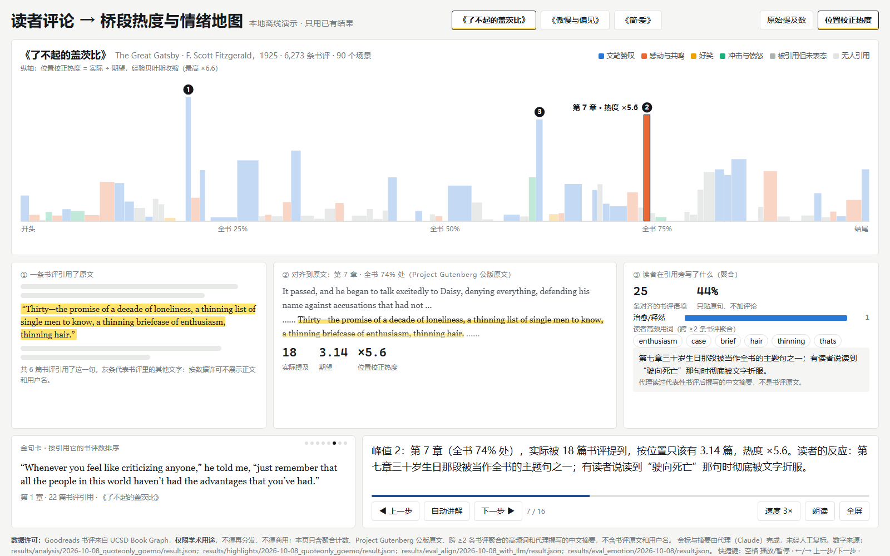

# 读者评论 → 桥段热度与情绪地图

把读者在书评里引用的句子当作现成的“标注”：找回它们在原著里的位置，校正位置偏差，画出一本书的“热度-情绪时间线”，看哪些桥段最打动人、读者有什么反应。

Shuyao Gao（gaoshuyao.mk@gmail.com）· aSSIST University (Seoul School of Integrated Sciences and Technologies) · 서울과학종합대학원대학교
**AI 教学演示案例 / AI Teaching Demos 系列**

**在线演示：https://shuyaogao.github.io/book-review-emotion-map/**（打开即自动讲解，约 2 分钟一轮）



> 数据说明：书评来自 Goodreads（UCSD Book Graph，仅限学术用途、不得再分发）。本仓库和页面**不含任何书评原文、用户名或逐条书评记录**，只有聚合计数、Project Gutenberg 公版原文的单句、跨 ≥2 条书评聚合的高频词，以及代理（Claude）撰写的中文摘要。金标也由代理标注，未经人工复标。

## 怎么打开

- **手机 / 电脑**：点上面的在线链接。
- **电脑离线**：Code → Download ZIP，解压后双击 `demo/demo.html`（或根目录的 `index.html`）。Windows 上也可以双击 `启动演示.bat`，它只是用 Edge 打开同一个页面。不需要安装、不需要联网。
- 完整展示页（数据可得性、位置偏差的合成数据检验、特征与情绪、局限）：`showcase/index.html`，在线地址 https://shuyaogao.github.io/book-review-emotion-map/showcase/index.html 。

## 怎么用

页面打开后自动播放 16 步讲解：三本书轮流出场，时间线从左到右生长，峰值处被引用的原句“飞”回原文位置并高亮。

| 操作 | 电脑 | 手机 |
|---|---|---|
| 播放 / 暂停 | 空格 | 点右下角“自动讲解” |
| 上一步 / 下一步 | ← / → | 点“上一步 / 下一步” |
| 切换书 | 1 / 2 / 3 | 点顶部书名 |
| 原始提及数 ↔ 位置校正热度 | R | 点顶部口径按钮 |
| 查看某个峰值 | 点时间线上带编号的柱子 | 同左 |
| 全屏 | F | — |

网址参数：`?auto=0` 不自动播放，`?step=7` 从第 7 步开始并停住，`?theme=light` 强制浅色。窗口窄于 980px 时页面排成一列，手机竖屏上下滚动查看。

## 课堂上怎么用

5–10 分钟的讲解顺序和备问见 [`DEMO_GUIDE.md`](DEMO_GUIDE.md)；展示页的 8 分钟讲稿见 [`showcase/DEMO.md`](showcase/DEMO.md)；18 页讲解幻灯片（带演讲者备注）是根目录的 `讲解.pptx`。

可以讨论的问题：

1. “被引用得多”等于“写得好”吗？开头和结尾为什么天然占便宜？
2. 为什么读者情绪这么少？只贴原句不表态的书评占多少？
3. 微信读书、豆瓣上的划线和书评能不能直接拿来用？（见 [`docs/DATA_FEASIBILITY.md`](docs/DATA_FEASIBILITY.md)）

## 它是怎么做的

1. **数据**：Goodreads 上《了不起的盖茨比》《傲慢与偏见》《简·爱》全部英文版本的 16,242 条书评；原文取自 Project Gutenberg，切成 624 个场景。
2. **引文对齐**：书评句子和原文共享罕见的 5-gram，或引号内片段与段落模糊匹配（rapidfuzz）。金标上精确率 60/60（95% CI 下限 94%），召回 26/28。
3. **情节对齐**（没直接引用、只描述情节的句子）：bge-m3 嵌入检索候选段落，再确认。金标上检索 top-1 / top-5 / top-8 召回为 8/36、19/36、24/36；确认器（规则与本机 1.7B 小模型）F1 都约 0.11，**还不能用**，主分析只用引文。
4. **位置校正**：书评偏爱首尾，划线越往后读的人越少。用“实际 ÷ 期望”再做经验贝叶斯收缩；在合成数据上，与真实吸引力的 Spearman 相关从原始计数的 0.72 提到 0.85（合成数据检验，不是真实数据的发现）。
5. **什么被引用**：场景层 Poisson GLM，格言式句子每 +1 SD，引用 ×1.19（95% CI 1.05–1.33，BH q = 0.052）；其余特征不显著。
6. **读者情绪**：先删掉书评里的原文，只看读者自己的话；32%–50% 的引用只贴原句不表态，有情绪的一半是“文笔赞叹”。

每个数字的出处（`results/…/result.json` 的键路径）见 [`docs/EVALUATION.md`](docs/EVALUATION.md)。检索召回以 `results/eval_align/2026-11-10_retrieval_recount/result.json` 为准；`2026-10-08_with_llm/result.json` 里的 `recall_at_5` 键名有误（实为 top-8），说明见同目录 `NOTE.md`。

## 想自己跑或修改

```powershell
# 环境（Windows，Python 3.12；torch 用 cu128）
python -m venv .venv
.venv\Scripts\python -m pip install -r requirements.txt
.venv\Scripts\python -m pip install torch==2.11.0 --index-url https://download.pytorch.org/whl/cu128

# 只改页面：改 demo/demo.template.html，然后从 showcase/data.json 重新生成 demo/demo.html（几秒钟，不需要数据集）
.venv\Scripts\python demo\build_demo.py
.venv\Scripts\python -m pytest -q
```

完整复现需要自行下载 UCSD Book Graph（约 8GB，仅限学术用途），见数据集主页；下载后：

```powershell
.venv\Scripts\python src\fetch_gutenberg.py          # 公版原文
.venv\Scripts\python src\goodreads_extract.py scan
.venv\Scripts\python src\goodreads_editions.py
.venv\Scripts\python src\goodreads_extract.py extract
.venv\Scripts\python src\goodreads_extract.py extract_dedup
.venv\Scripts\python src\segment.py
.venv\Scripts\python src\pipeline.py features
.venv\Scripts\python src\pipeline.py align --confirm quoteonly
.venv\Scripts\python src\pipeline.py emotion --confirm quoteonly
.venv\Scripts\python src\pipeline.py analyze --confirm quoteonly --emo goemo
.venv\Scripts\python src\highlights.py
.venv\Scripts\python src\heat.py simulate
.venv\Scripts\python src\build_showcase.py
```

`src/gold_sample.py` 用固定种子重新生成金标抽样清单（发布版不含这份清单，因为它逐条指向书评）。
读者自己导出的微信读书划线可以用 `src/adapters/weread_export.py` 转成段落热度（不访问任何接口）。

## 目录

```
demo/                      自动讲解演示页 demo.html（离线单文件，由 build_demo.py 从 showcase/data.json 生成）
showcase/                  完整展示页 index.html、data.json、figs/、讲稿 DEMO.md
src/                       管线：切分 segment / 嵌入 embed / 对齐 align / 情绪 emotion / 特征 features /
                           热度 heat / 模型 model / 高光 highlights / 评估 eval_* / 汇总 build_showcase
src/adapters/              微信读书本人导出文件的适配器
server/llm_annotate.py     GPU 服务器上多个开源模型标注 + 一致性（带退化守卫）
configs/books.json         书目、Gutenberg 编号、章节正则、人名表
data/gold/labels/          金标标注结果（代理标注，只含条目编号）
results/<阶段>/<日期>_<标签>/  _env_stamp.json + result.json（+ 场景层 raw/）
docs/                      DATA_FEASIBILITY 数据可得性与合规 / CODEBOOK 编码手册 / EVALUATION 方法与数字
tests/                     单元测试
```

## 常见问题

- **页面会不会上传数据？** 不会。页面是纯静态文件，没有后端、没有统计脚本；关掉标签页就全部结束，不留后台进程。
- **为什么看不到书评原文？** 数据集许可不允许再分发。页面用聚合高频词和代理撰写的中文摘要代替，摘要旁注明“不是书评原文”。
- **“朗读”没声音？** 需要系统装有中文语音；没有就只看字幕。
- **能不能直接抓微信读书的热门划线？** 不能批量抓（服务协议条款、2025 年修订的《反不正当竞争法》第十三条第三款、相关判例），详见 `docs/DATA_FEASIBILITY.md`。

## 许可证与引用

代码 MIT（`LICENSE`），文档与教学素材 CC BY 4.0（`LICENSE-docs`），使用请注明出处。引用信息见 `CITATION.cff`。书籍原文、数据集和模型的许可见 `THIRD_PARTY.md`。

## AI 辅助开发声明

代码、文档和页面由 Claude Code 辅助编写，经作者审阅。金标标注和页面上的中文摘要由代理（Claude）完成，未经人工复标，对外引用结论时请注明。

## English summary

**Book Review Emotion Map** treats the sentences that readers quote in book reviews as free annotations. Quotes from 16,242 Goodreads reviews of *The Great Gatsby*, *Pride and Prejudice* and *Jane Eyre* are aligned back to the public-domain Project Gutenberg texts (624 scenes) using rare 5-gram shingles and fuzzy matching (precision 60/60 on an agent-labelled gold set). Mention counts are corrected for position bias with an observed/expected ratio and empirical-Bayes shrinkage, and the result is shown as an auto-playing heat-emotion timeline in which quotes fly back to their place in the novel. Plot-level alignment via bge-m3 retrieval (top-1/5/8 recall 8/36, 19/36, 24/36) is not yet usable. Only aggregate statistics are published — no review text, user names or per-review records, as the UCSD Book Graph data is for academic use only. Live demo: https://shuyaogao.github.io/book-review-emotion-map/ . Part of the *AI Teaching Demos* series by Shuyao Gao, aSSIST University. Code MIT, docs CC BY 4.0.
